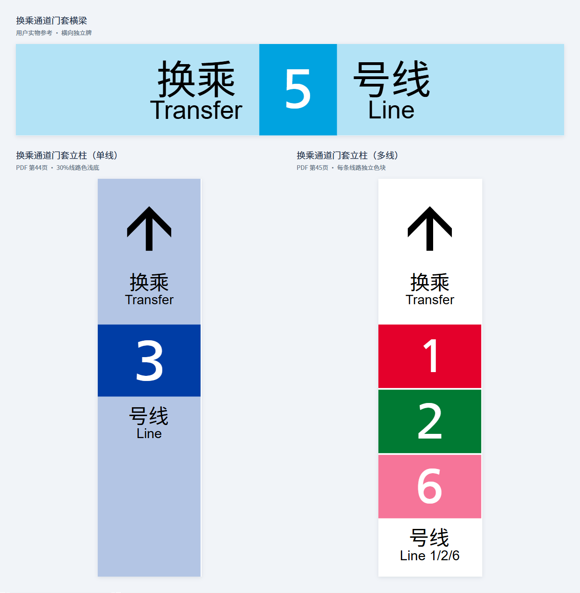
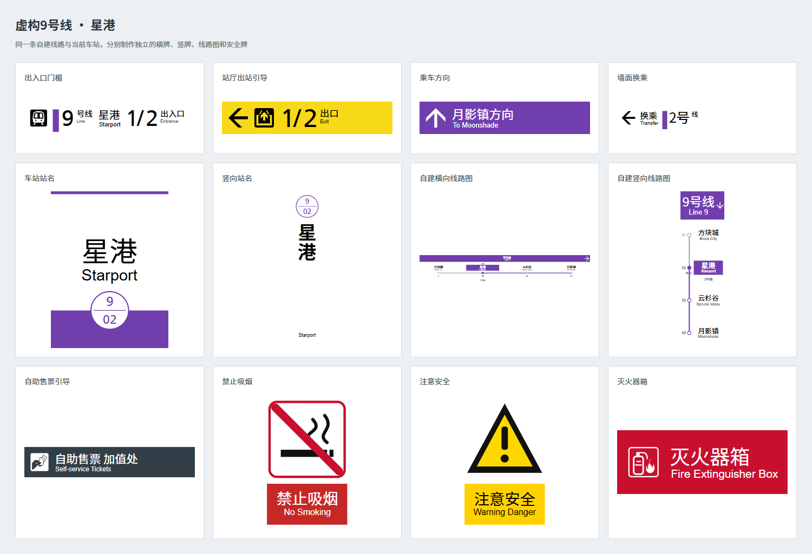
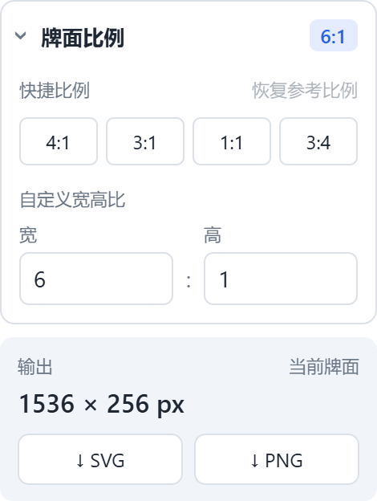
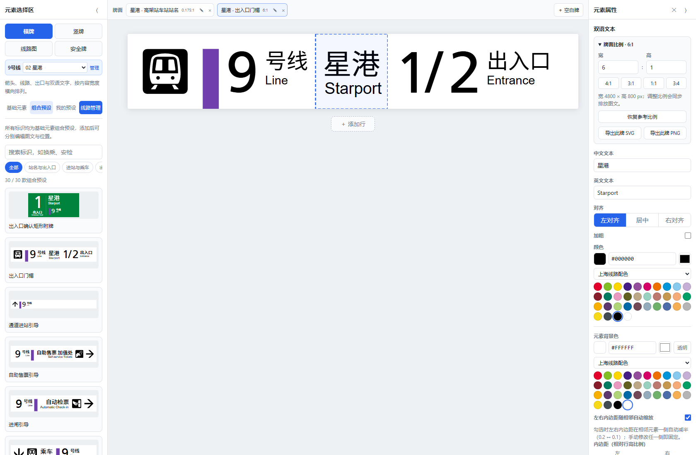

# Motiquies Sign System

基于原项目 [JR-Guidance-Sign-Web-Editor](https://github.com/endcreeper861/JR-Guidance-Sign-Web-Editor) 扩展的轨道交通标识编辑器。

面向 [Motiquies Minecraft 服务器](https://motiquies.yuchan.moe/)的铁路与城市轨道交通标识制作，也可为自己的虚构城市建立线路和车站标识。

**计划在线入口：** [sign.motiquies.yuchan.moe](https://sign.motiquies.yuchan.moe/)（计划部署地址，尚未验证上线）。

项目仓库：[YU322142/Motiquies-Sign-System](https://github.com/YU322142/Motiquies-Sign-System)。

JR风格导向标识牌 Web 编辑器。类似国内的重庆轨道交通（CRT）、成都地铁风格，但不完全相同。

打开 `index.html` 即可使用，在同一工作区制作多块独立的导向标识牌，所见即所得地编辑并导出为自包含的 SVG / PNG。

> 项目从Python原型 `sign_jr.py`（Pillow 位图渲染）迁移而来，渲染比例与排版规则均移植自该参考实现。领域术语与设计决策见 [CONTEXT.md](CONTEXT.md) 与 [docs/](docs/)。

## 重庆矩形标识扩展

参考所提供的《重庆市轨道交通客运服务标志标准》181 页扫描件，并补充用户实物中的换乘通道横梁，当前提供 **81 款矩形标识组合预设**。左侧分为 **横牌、竖牌、线路图、安全牌** 四个专区，每区提供基础元素、组合预设和我的预设，并支持用途筛选和搜索。时刻表、地图以及「出入口确认矩形附牌」「自动检票机通行状态」「票价表」已移出当前预设库，旧项目中的内容仍可恢复。

每次添加组合预设都会建立一块独立牌面，可在编辑区上方的牌面卡片中切换。竖向站名牌与横向门楣分别保存尺寸和布局，不会拼成同一张图。预设内部由普通基础元素组成：箭头、线路、出入口、双语文字、单行文字、图形和符号，图文可分别选中、修改、拖动及调整前后顺序。「添加行」只给当前牌面增加一行。

四方体导向牌可通过右栏「编辑各排内容与顺序」设置 1～12 排信息，逐排填写左右方向的中英文及线路中英文，添加、删除或上下移动。参考比例随排数调整，并保留此前手动设置的比例倍率；排内容、顺序和比例随项目及我的预设保存。各排中的基础元素仍可独立编辑，详见[操作与截图](docs/fictional-lines.md#编辑四方体多排标识)。

搜索「换乘通道」可找到横牌中的门套横梁和竖牌中的单线／多线立柱。线路号位于完整线路色块内，数字随底色自动选择黑白；多线立柱逐条使用各自线路颜色。横梁依据用户实物补充，PDF 的门套示例为竖柱，参考比例均可编辑。



每行可单独设置牌面比例，预设行同时保留参考宽高比。「牌面比例」中提供快捷比例、自定义宽高比和恢复参考比例；单行牌无需选择行，多行牌可选择要调整的行。输出像素尺寸与 SVG／PNG 按钮单独显示；选中元素时，输出区位于属性末尾，文字编辑仍在前面。保存到我的预设时也会保留比例、底色和线路数据。

所有元素支持项目 JSON 导入导出、自动保存、保存为行预设及自包含 SVG／PNG 导出。旧版整牌存档仍可打开，并可转换成基础元素。符号使用内嵌矢量，文字保留为 SVG 文本。



范围只包括矩形牌面，内部的圆形禁令和三角警告符号保留；箭头轮廓、圆牌、削角牌等暂缓。标准指定的微软雅黑使用项目原有的内嵌思源黑体替代，屏幕色采用潘通近似值。逐项来源、尺寸及历史项目兼容范围见 [重庆标准覆盖记录](docs/chongqing-standard.md)。

## 为 Minecraft 虚构线路制作标识

先打开左侧「线路管理」，新建自己的线路，填写线路中英文名、自定颜色，以及各站的中英文名、编号和换乘信息。选择本站后，可生成横向或竖向线路图，也可点击「用于制作车站标识」。

此后在左侧选择当前车站，再添加门楣、站名、分向、换乘等组合预设，会自动复用这条线路及当前站的相关信息。切换车站只影响以后添加的标识，已经制作的牌面会保留。线路名称、站名和颜色都可以自定义，无需使用真实城市线路。

保存线路后，颜色选择器中的「我的线路」会显示带线路名称的色块。数字线路、文本线路可直接选择已保存线路；开启自动配色后，输入匹配的线路号或线路名也会使用其自定色。填写换乘时，各条已定义线路分别使用自己的颜色；所需的外线名称和颜色快照随线路文件及项目保存。明确选择上海、重庆或成都配色后，后续自动匹配遵循所选来源。

在线路元素的线路色条／色块选择器中，点击唯一对应一条线路的色块，会同时填入编号或中英文线路名及颜色。通用色只改颜色；同色多线不自动猜编号，可用「从我的线路选择」明确指定。

线路可保存到本地库或导出为独立的 `.railway-line.json` 文件；项目 JSON 保存工作区中的整套独立牌面。标识牌设置中的 SVG／PNG 导出只输出当前牌面；选中某行后，在属性末尾的「输出」区可单独输出当前行，无需展开比例设置。详细步骤与文件区别见 [虚构线路入门](docs/fictional-lines.md)。





## 服务器公共线路

网站可通过静态 `data/lines.json` 提供服务器公共线路列表。在线路管理中将来源切换为「服务器线路」，点击「刷新服务器列表」后选择线路，可「用于制作车站标识」或「放入牌面」生成线路图；点击「另存到我的线路」会创建新的本地副本。公共列表与浏览器本地线路分开管理，选用公共线路不会自动保存到本地，修改个人副本也不会改动网站资料。

管理员先在编辑器中创建并保存所需线路，再点击「导出服务器线路列表」，使用网站部署权限将下载的 `lines.json` 替换为 `data/lines.json`。导出包含本地库中全部已保存线路，不包含未保存草稿。网页不提供管理员密码或账号；发布权限由网站托管、仓库和部署系统控制。文件格式与操作流程见[服务器线路管理指南](docs/server-lines.md)。

## 功能特性

- **元素**：方向图标（12 向）、数字线路、文本线路、双语文本、大文本、出入口、出口、服务设施与安全消防图标、单行文字、矩形、圆形、线段及空白占位。预设中的路径和多边形也可独立编辑颜色、位置与尺寸。
- **工作区**：多块独立牌面通过顶部卡片切换，各自保留宽高比、元素和行；项目 JSON 一起保存。
- **标识牌**：当前牌面内行高统一、行数不限；宽度支持固定 / 动态（最宽行决定）两种模式，可锁定宽高比。
- **行比例**：每行保留参考比例和当前比例，支持修改与恢复；自由排版同步调整横向位置和宽度，文字与图形仍按自身比例适配。
- **自建线路**：编辑各站名称、编号、换乘、本站和运行方向，生成横／竖线路图；线路库、独立线路文件、项目文件和导出的图片分别保存对应内容。
- **服务器线路**：读取网站发布的公共线路，选站制作标识或另存本地；管理员可导出多条线路的公共列表文件，再通过网站部署发布。
- **线路配色**：任意颜色选择器顶部可选「服务器线路」「我的线路」或上海 / 重庆 / 成都。公共及自建线路显示带名称的色块，同色线路合并；数字和文本线路支持选择线路及自动匹配。使用公共线路制作标识时自动选用服务器配色；自动配色开关位于标识牌设置 → 编辑器，匹配遵循明确选择的来源。
- **自动黑白**：关联背景的文字、箭头和线路号会随底色变动选择黑白；手动改文字颜色后保留手选色，可勾回「随背景自动黑白」。关联随项目和我的预设保存。
- **内容对齐**：数字线路、文字线路、出口支持元素内左/右对齐（属性 `align`），右对齐时色块移至右缘、出口编号移至「出口」右侧，贴合现实右置导视牌；数字线路右对齐仅渲染第 1 条线路。与固定宽度模式的元素对齐相互独立。
- **固定宽度元素对齐**：元素可贴左 / 居中 / 贴右，三条通道独立排列（可能重叠，属设计之内，调大牌宽解决）；动态宽度模式下整体左起排列。
- **相邻自动内边距**：元素开启「随相邻自动缩放」时，左右内边距在紧邻其他元素的一侧自动减半（0.2 ↔ 0.1），删除邻居自动恢复；手动修改即固定。空白占位不算邻居。
- **墨区排版**：数字线路的数字间距、首位与色条的间距均按字形墨区（`actualBoundingBox*`）计算，「1」等窄字与其他数字视觉间距一致；数字与「号线」标签墨区顶对齐。
- **灰框**：可为标识牌开启自定义宽度的灰色直角边框（牌面边缘向内延伸，覆盖于内容之上），每一行独立成框，模拟真实标识牌的金属边框效果；随 SVG/PNG 一同导出。
- **导出**：SVG／PNG 输出当前牌面或当前行，其他独立牌面不会拼进图片。SVG 内嵌 @font-face 字体（按需收集），PNG 按像素尺寸光栅化。
- **自动保存**：localStorage 防抖落盘，刷新恢复；多标签页实例守卫。
- **预设**：内置组合预设由基础元素生成；任意行可保存为我的预设，保留比例、位置和尺寸，再次添加时建立独立牌面。

## 本地运行

无需安装任何依赖：

```bash
# 直接双击 index.html，或起一个静态服务器：
python -m http.server 8000
# 浏览器打开 http://localhost:8000
```

## 测试

```bash
node --test          # 状态模型 + 纯几何（Node 内置 test runner，无依赖）
```

- `test.html` —— 浏览器 DOM 测试（真实字体下的墨区级断言、渲染结构、导出）
- `e2e.html` —— iframe 驱动的端到端交互测试（选中/拖拽/面板/导出等），结果同时写入 localStorage

## 图标库再生成

图标数据内嵌于 `js/icons.js`（源为另一项目的服务设施与方向 SVG）。源图标更新后重新生成：

```bash
node gen-icons.mjs <图标源目录>   # 目录下含 *.svg 与 arrows/*.svg
```

## 静态部署

纯静态站点，`index.html` 位于仓库根目录，可部署到 GitHub Pages 或其他静态托管。GitHub Pages 可在仓库 Settings → Pages 中选择从分支根目录部署；自定义域名按托管平台配置。

发布时一起上传 `data/lines.json`，公共线路列表位于相对网站入口的这一地址。首次提供空列表也可以；之后更新该文件即可发布新线路，无需修改编辑器代码。计划使用的在线域名见本页开头，当前不作为已上线验证记录。

## 目录结构

```txt
index.html            应用入口
style.css             全部样式
js/                   应用代码（IIFE 模块，加载顺序见 index.html）
  crt-catalog.js      重庆矩形牌预设目录、参考尺寸、默认字段及标准来源
  crt-render.js       预设几何指令与旧整牌兼容绘制（metrics / draw）
  crt-symbols.js      重庆补充符号（独立矢量源，保留原图标生成管线）
  core.js             常量/工具/字体度量/文本测量（含墨区度量）
  icons.js            图标库数据（生成物，勿手编）
  state.js            SignState 纯函数状态模型（不可变）
  render.js           SVG 渲染引擎（metrics 纯几何 + draw DOM 双轨）
  composition.js      四个专区、共用排版片段、车站信息复用与基础元素组合
  routes.js           自建线路模型、本地线路库、独立线路文件与线路图生成
  line-catalog.js     服务器公共线路列表校验、刷新与管理员导出
  workspace.js        独立牌面切换、快照保存与旧混排项目迁移
  ui.js               全局 App 上下文、toast/模态、DOM 工具
  panel.js            左栏元素选择区 + 右栏属性/设置面板
  interact.js         编辑区交互（选中/拖拽/落点指示/行管理）
  presets.js          行预设（localStorage）
  storage.js          自动保存/实例守卫/项目 JSON 导入导出
  exporters.js        SVG/PNG 导出（内嵌字体）
  main.js             启动装配（字体预加载 → 恢复状态 → 首帧）
fonts/                字体文件（构建产物）
fonts-data.js         字体 base64 内嵌数据（构建产物，导出时懒加载）
data/lines.json       网站部署发布的公共线路列表
gen-icons.mjs         图标库生成脚本
test.html / e2e.html  浏览器测试页
test/                 Node 单元测试
docs/                 开发文档（ADR、开发指南）
CONTEXT.md            领域术语表
AGENTS.md             AI 协作指引
LICENSE               开源协议文件（Apache-2.0）
NOTICE                上游来源、署名与本版本修改说明
```

## 文档

| 文档 | 内容 |
| --- | --- |
| [CONTEXT.md](CONTEXT.md) | 领域术语表（标识牌/行/元素/元素对齐/图标等，含"避免用词"） |
| [docs/development.md](docs/development.md) | 开发指南：架构、状态流、新增元素类型清单、字体与图标管线、测试约定 |
| [docs/fictional-lines.md](docs/fictional-lines.md) | Minecraft 虚构线路入门：建线、选站、制作标识及文件保存 |
| [docs/server-lines.md](docs/server-lines.md) | 服务器公共线路：访客使用、管理员导出、文件格式与部署发布 |
| [docs/adr/0001-svg-rendering-engine.md](docs/adr/0001-svg-rendering-engine.md) | ADR：为什么选 SVG 作为渲染引擎 |
| [docs/code-review-2026-09.md](docs/code-review-2026-09.md) | 代码审阅记录：隐患清单、修改措施与"审阅过但不改"的决策 |
| [AGENTS.md](AGENTS.md) | AI 协作快速上手 |

## 字体与图标来源

- `fonts/` 与 `fonts-data.js` 为构建产物：思源黑体子集化（GB2312 全量字符，fonttools 生成）+ Helvetica / Frutiger（数字与西文）。**不要手工编辑**，再生成管线见 [docs/development.md](docs/development.md)。
- 服务设施与方向图标移植自 signmaker-main 项目的 `icon` 目录，已内嵌为 SVG path 数据。

## 许可证与来源

沿用上游的 [Apache License 2.0](LICENSE)。原项目来源及本版本修改说明见 [NOTICE](NOTICE)；保留上游提交历史与署名。

上游项目为 [endcreeper861/JR-Guidance-Sign-Web-Editor](https://github.com/endcreeper861/JR-Guidance-Sign-Web-Editor)，[上游原版在线示例](https://endcreeper861.github.io/JR-Guidance-Sign-Web-Editor/)不包含本版本扩展。字体与图标保留各自来源说明，项目许可证不替代适用的第三方条款。

