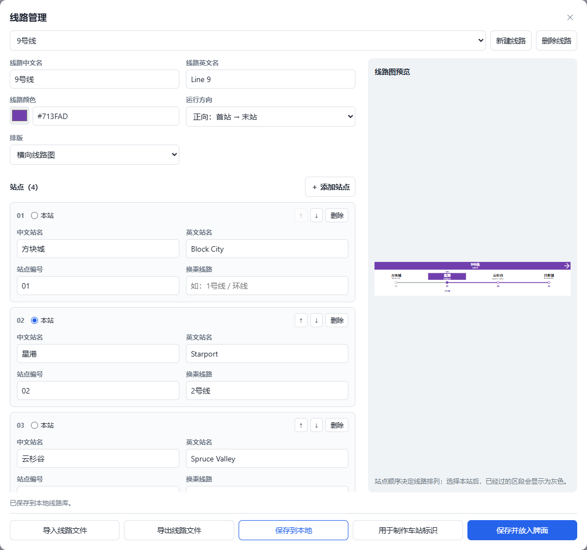
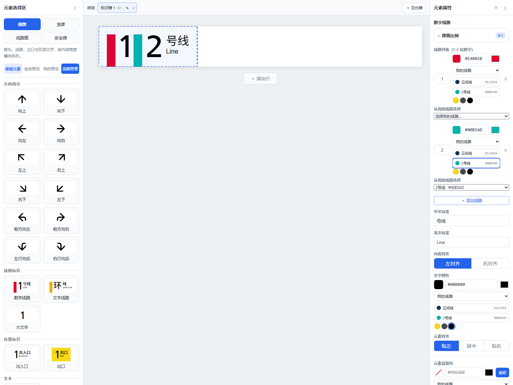
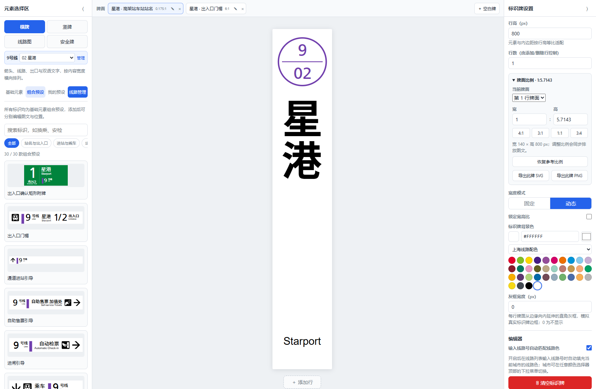
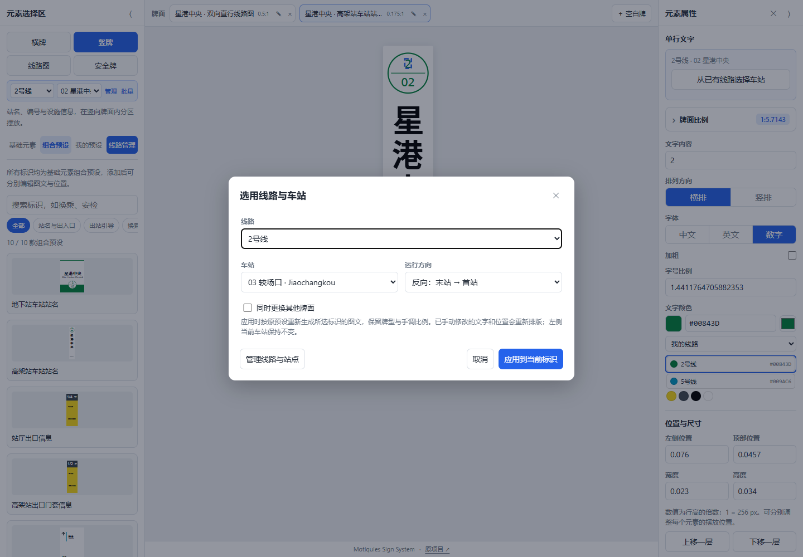
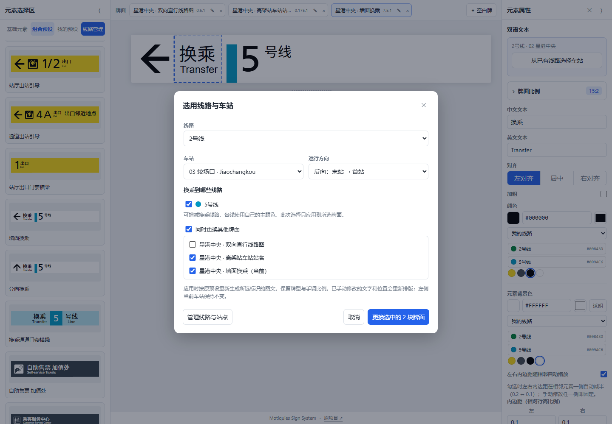
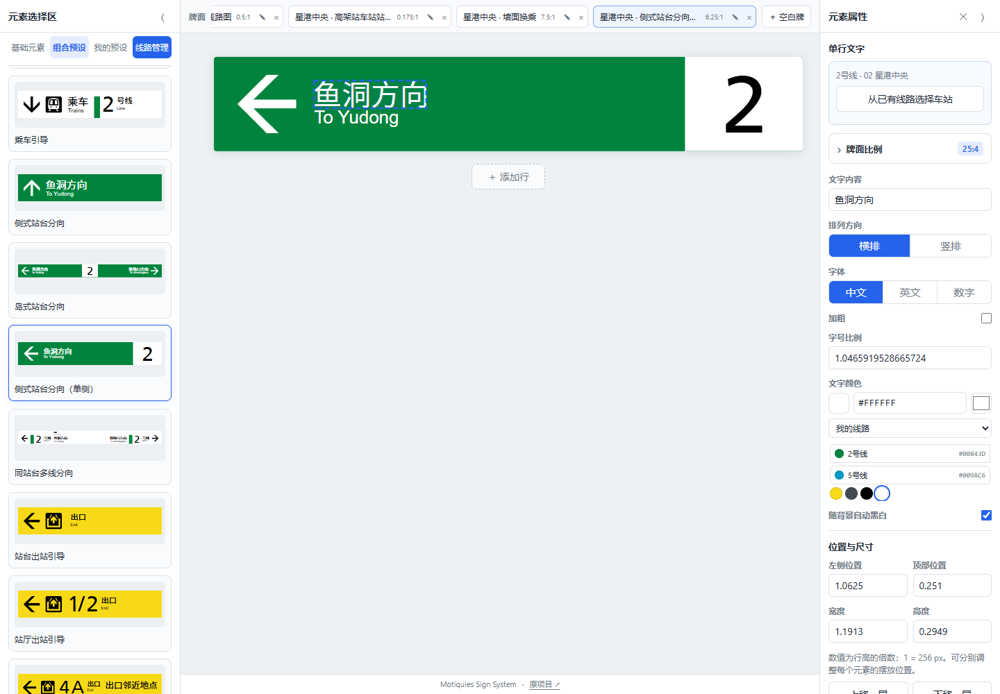
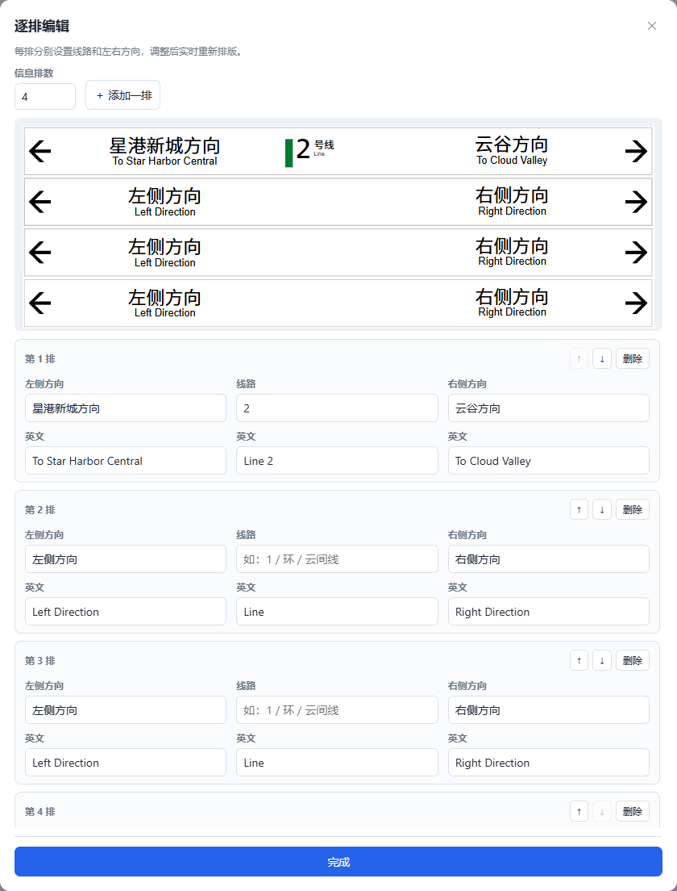

# 为虚构线路制作车站标识

可先为 Minecraft 城市建立一条完整线路，再用同一套数据制作各站的门楣、站名、乘车方向和换乘标识。线路、站名、编号和颜色都由你填写。

如果网站已经发布服务器公共线路，可在线路管理中选择来源「服务器线路」，点击「刷新服务器列表」后选用，直接制作车站标识或线路图；这些操作不会自动写入本地库。需要自己的修改版时，点击「另存到我的线路」建立新的本地副本。公共列表与个人本地资料分开保存。管理员发布方式见[服务器线路管理](server-lines.md)。

## 建立线路

1. 打开左侧「线路管理」，点击「新建线路」；无需先切换专区。
2. 填写线路中英文名与线路颜色。例如自建的「9号线 / Line 9」，使用自己选择的紫色。
3. 逐站填写中英文名、站点编号和换乘线路。可以添加、删除或上下移动站点；编号为文字，可使用 `01`、`A02` 等格式。
4. 选择本站和运行方向。预览会高亮本站，将已过的区段显示为灰色。
5. 点击「保存到本地」。需要在其他浏览器或电脑继续时，再点击「导出线路文件」。

## 复用自己的线路颜色

保存线路后，在任意颜色选择器顶部选择「我的线路」，就能看到带线路名称的色块。例如先保存紫色「9号线」和橙色「10号线」，以后可直接选用，颜色相同的线路会合并显示名称。

在数字线路的每条线路色条中点击「2号线」色块，会同时将该条编号改为 `2` 并应用线路色，不影响其他条目。在文本线路的「色块颜色」中点击「云间线」，会同时填写中文名、英文名和颜色；开启「线路名下沉」时，大字填写「云间」，末尾「线」由小标签显示。点击出口黄、灰、黑、白等通用色只改颜色；同色对应多条线路时也只改颜色，请用「从我的线路选择」指定线路。真实城市色板同样只在颜色唯一对应一条线路时自动填入，重庆的共用蓝色不会被猜成某一线路。

数字线路和文本线路的属性中都有「从我的线路选择」。开启标识牌设置 → 编辑器中的自动配色后，在数字线路输入 `9`，或在文本线路输入已定义的「云间」「云间线」，也能匹配保存的线路颜色。名称按完整别名匹配，不用部分文字猜测线路；当前制作线路与其他线路同号时，优先使用当前线路的颜色。

各站的换乘栏可填写 `9号线 / 10号线`，也可用顿号、逗号或换行分隔。先建立并保存这些线路，生成线路图时，匹配到的每条换乘线路分别使用自己的颜色；未定义的线路不会自动借用某个真实城市的同号线颜色。当前仍是彩色文字标注，圆形换乘图形和编号标记尚未按 PDF 完整实现，详见[标准实现边界](chongqing-standard.md#编辑器实现边界)。

保存或导出时，实际用到的外线名称和颜色以 `relatedLines` 快照随线路数据保留，项目 JSON 也会保存这部分信息。因此把文件带到另一台电脑后，仍可复用这些换乘颜色，无需重新建立外线；快照不包含外线的全部站点。删除某项换乘后，不再使用的快照会清理。

如需使用真实城市色板，在选择器中明确选择上海、重庆或成都，后续自动匹配就遵循该来源。重新选择「我的线路」后再使用自建配色；切换来源不会批量改写已完成牌面的颜色。

## 制作当前车站的各种标识

在线路管理中点击「用于制作车站标识」，回到左侧后从「当前车站」选择要制作的站。例如先选「星港 / Starport」，再添加横牌、竖牌和线路图预设。

相关预设会复用线路名、自定颜色、站名、站点编号、全线站点或终点方向；设施牌与安全牌保留各自的用途文字。出入口编号仍可单独编辑，不会被车站编号替换。

每次添加组合预设会新建一块独立牌面。可以在编辑区上方的卡片中切换，例如分别打开竖向站名牌和横向门楣；它们保留各自的尺寸和布局。牌面内部的文字、图标和图形都是可以分别编辑的基础元素。选中其中任意元素后，展开右栏「牌面比例」可选快捷比例或填写自定义宽高比；「恢复参考比例」回到预设的参考比例。

制作换乘通道标识时，可在横牌搜索「换乘通道门套横梁」，在竖牌选择单线或多线立柱。填写「10号线」时色块内只显示「10」，「星环线」显示「星环」；下方或右方的线路单位独立排列，留空时自动选择「号线」或「线」，也可手动填写。线号与完整线路色块分别可编辑；修改色块填充色后，绑定的数字自动改为黑或白。手动选择数字颜色会退出自动配色，再勾选「随背景自动黑白」即可恢复。多线立柱的色块分别匹配各条已定义线路。

比例设置只包含调整比例所需的控件，像素尺寸与 SVG／PNG 按钮位于独立的「输出」区。单行牌隐藏行选择器；多行牌在标识牌设置中显示「调整哪一行」。选中元素时，比例设置位于属性顶部，输出区位于属性末尾，不挤占文字输入位置。

需要给同一块牌增加信息带时使用「添加行」。独立牌面与牌内多行分开管理，添加另一种标识无需先加一行。

完成这一站后，切换左侧当前车站，再添加下一站所需的牌面。**切站只影响以后添加的内容，已经制作的标识保持原样。** 修改线路库数据也不会自动重写已经完成的牌面。

## 切换独立牌面

编辑区上方的卡片列出已经制作的标识。点击卡片切换当前牌面；例如竖站名牌与横门楣各占一张卡片，切换时保留各自的比例、元素和行。卡片上的铅笔可重命名，「×」可删除该牌面。

「＋ 空白牌」用于新建另一块独立标识；牌面下方的「添加行」用于给当前这块标识增加一行。项目 JSON 会一起保存所有卡片中的牌面。

## 制作整条线路图

已保存的线路可直接在左侧线路下拉框选择，再选择当前车站。线路来自「我的线路」或「服务器线路」，无须先进入管理面板。

选好线路与站点后添加标准线路图组合预设，会采用完整站表、按站点 ID 确定的本站、运行方向和换乘线自己的配色。双向、支线等预设保留各自的版式；点击添加与拖入使用相同数据。

在线路管理中选择横向或竖向排版，点击「保存并放入牌面」，建立独立的线路图牌面。生成的站名、站号、换乘、圆点与连接线都是基础元素，仍能单独修改。

需要改动线路本身时，选择该线路图行的任意元素，点击右栏「编辑此线路」，修改后点击「保存并更新牌面」。该操作只更新选定的线路图行。站点较多时会缩小站点信息，可配合更大的行高和编辑区缩放检查细节。

## 更换已有标识的车站

选中站名、门楣、运行方向或换乘标识中的任意元素，在右栏点击「从已有线路选择车站」。从已有线路及站点选择；同名站通过站号、英文与独立 ID 区分。选站窗口读取线路库的最新站表，线路库不存在对应线路时仍可使用项目保存的快照。

换乘标识可勾选要显示的已有线路，各线分别使用自己的名称和主题色。此次选择只修改牌面，不会写回线路库或服务器列表。

勾选「同时更换其他牌面」，再勾选需要更新的牌面即可批量更换；左侧「批量」按钮也可直接进入此操作。未勾选的牌面保持原样。应用时按预设重新生成图文、保留牌型及手调比例，手动编辑的文字与位置会重新排版；左侧当前车站不会随此操作改变。

## 编辑整段竖排文字

新建竖站名牌的中文站名是一个基础文字元素，选中后在「文字内容」一次输入完整站名；「排列方向」可切换横排／竖排，「竖排字间距」调整整段间距。移动、颜色和导出也以完整文字为单位。

旧项目中的逐字元素保留原布局。通过「从已有线路选择车站」重新应用站点，或重新添加预设，可获得整段竖排文字。

横牌中的「侧式站台分向（单侧）」沿用岛式布局，保留左箭头、双语方向及右端白底线路号，删除另一侧方向区域，参考尺寸为 2000×320，仍可调整比例。

## 编辑四方体多排标识

添加「四方体悬挂标识（单面）」组合预设后，点击右栏「编辑各排内容与顺序」。可设置 1～12 排，每排分别填写左侧方向中英文、线路中英文和右侧方向中英文；使用「添加一排」、删除及上下箭头调整内容和顺序，修改会实时显示在预览中。

参考宽高比按「单排参考比例 ÷ 排数」调整，增加排数时比例降低，减少时提高。若先前手动设置为参考比例的某个倍率，改变排数后会沿用该倍率；「恢复参考比例」可回到当前排数的参考值。这里的「排」是四方体牌内的信息排，无需使用牌面下方的「添加行」。

排内容、顺序和比例随项目 JSON 及我的预设保存，再次打开仍能逐排编辑。也可直接选中文字、线路或图形等基础元素分别修改；修改已有方向文字和线路后再调整排数，不会恢复成示例内容。

## 保存哪一种文件

| 保存方式 | 保存内容 | 适合用途 |
| --- | --- | --- |
| 保存到本地 | 当前浏览器中的线路库 | 下次在同一浏览器选用这条线路 |
| 导出服务器线路列表 | 本地库全部已保存线路，格式为 `railway-line-catalog`，不含未保存草稿 | 管理员将下载的 `lines.json` 替换到网站 `data/lines.json`，经部署发布给访客 |
| 导出线路文件 | `.railway-line.json`：线路名、颜色、各站、本站、方向及所需外线配色快照 | 迁移线路数据、制作其他站的标识 |
| 导出项目 JSON | 工作区中全部独立牌面、各自尺寸与布局、共享的当前线路和车站，含四方体逐排编辑数据 | 继续编辑整套标识 |
| 保存为我的预设 | 当前行的基础元素、比例、底色、已有线路图及四方体逐排编辑数据 | 在同一浏览器复用自己排好的牌面 |
| 导出此牌 SVG／PNG | 选中行的单张标识，保留该行的牌面比例 | 单张展示或 Minecraft 贴图处理 |
| 标识牌设置中的导出 SVG／PNG | 当前牌面，包含这块牌内部的所有行 | 输出当前这块完整标识 |

线路文件导入位于「线路管理」，项目 JSON 导入位于标识牌设置。两种文件格式各自验证；将线路文件导入项目入口不会替代线路管理。

要制作贴图，先通过顶部卡片切换到所需牌面，再从标识牌设置导出当前牌面的 SVG／PNG。如果只需要这块牌中的某一行，选中该行任意元素，到属性末尾的「输出」区点击 PNG 或 SVG，无需展开比例设置。其他独立牌面都不会拼进图片。线路文件保存原始线路资料，项目 JSON 保存整套可编辑标识，图片则用于你自己的展示或贴图流程。

当前新增库包含横牌、竖牌、线路图、安全牌四个专区，共 82 款组合预设，含依据用户实物补充的换乘通道门套横梁及单侧站台分向牌。时刻表、地图以及「出入口确认矩形附牌」「自动检票机通行状态」「票价表」已移出新增库，旧项目仍能打开已有内容。
